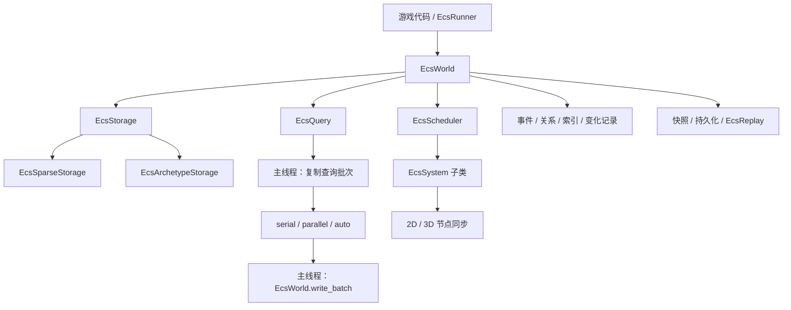

# ECSmini 0.3 技术架构说明

本文描述 `addons/ecsmini` 当前实现的模块边界、运行流程、并发规则和数据恢复语义。面向接入 ECSmini 的玩法开发者，以及维护插件运行时、适配器和测试的开发者。完整示例和 API 细节见文末的专题文档。

## 1. 产品边界

ECSmini 是 Godot 4.7 项目的纯 GDScript ECS 运行时。插件附带轻量 `EditorPlugin` 入口；当前入口不注册编辑器面板或自定义 Inspector。运行时类由 `class_name` 注册，可在未启用该编辑器插件时使用。项目不需要 ECSmini Autoload 或外部依赖。

插件负责实体生命周期、组件存储、查询、系统调度、批量数学计算、数据扩展、快照和受控回放。植物、僵尸、战斗、关卡规则及游戏输入仍由宿主项目负责。2D/3D 节点是呈现对象，ECS 数据不依赖场景节点存活。

插件没有自带的 C++、GDExtension 或平台二进制运行时。批量 `parallel` 模式调用 Godot 的 `WorkerThreadPool`；计算内核、任务管理、结果校验和 ECS 提交逻辑均由插件的 GDScript 实现。

## 2. 模块拓扑



| 模块 | 主要职责 | 入口 |
| --- | --- | --- |
| `ECSmini` / `EcsWorld` | 创建世界；拥有实体 ID、UID、存储、查询、系统、模拟时钟与变更边界 | `runtime/ecsmini.gd`、`runtime/ecs_world.gd` |
| `EcsStorage` | 统一存储契约 | `runtime/storage/ecs_storage.gd` |
| Sparse / Archetype 存储 | 组件列存储，或按精确组件签名组织 Chunk | `runtime/storage/ecs_sparse_storage.gd`、`ecs_archetype_storage.gd` |
| `EcsQuery` | `all` / `any` / `none` 成员关系、增量刷新、稳定遍历和批次导出 | `runtime/ecs_query.gd` |
| `EcsSystem` / `EcsScheduler` | 声明系统阶段、依赖和读写集合，并建立确定的执行顺序 | `runtime/ecs_system.gd`、`runtime/ecs_scheduler.gd` |
| `EcsRunner` | 将世界接入 Godot process 或 physics 时钟，可选拆分模拟和呈现阶段 | `runtime/ecs_runner.gd` |
| Compute | 对齐的 PackedVector2/3 批次计算 | `runtime/compute/ecs_batch_compute.gd` |
| Extensions | 模板、事件、关系、组索引、空间索引和组件注册 | `runtime/extensions/` |
| Persistence | 安全编码、快照、文件存储、检查点、回放和纠正输入 | `runtime/persistence/` |
| Godot adapters / debug | 将 ECS 状态同步至 Node2D/Node3D；提供显式调试 UI | `integrations/`、`debug/` |

## 3. 核心数据模型与所有权

`EcsWorld` 是实体生命周期和状态变更的唯一权威入口。运行时实体 ID 使用 `(generation << 32) | slot` 编码，供一个 World 内部引用；实体还可拥有稳定的正整数 UID，用于保存、加载和恢复后的重新绑定。恢复会创建新的运行时 ID，持久 UID 保持稳定。

组件以 `StringName` 作为键，以 `Variant` 保存值。应用可选择注册组件类型、验证器和句柄组件。只有明确登记为句柄组件的整数值会在恢复时按 ID 映射重写；普通整数按普通数据保留。

`EcsWorld.storage` 对应用代码是内部实现边界。应用通过 World 的生命周期、组件和批量写入方法修改状态。直接调用 Storage 的快速写入接口会绕过 World 的验证、查询通知、索引和变更记录。

World 的 Tick、flush、restore、扩展构造和状态变更由创建线程负责；查询、索引和场景节点遵循各自的主线程/场景线程所有权约定。Worker 只接收独立的 PackedArray 输入与输出，不持有 World、Resource 或 Node 引用。

## 4. 存储与查询

| 后端 | 组织方式 | 适用侧重点 |
| --- | --- | --- |
| `EcsSparseStorage` | 每个组件使用紧凑实体数组、对齐值数组和实体到行索引；删除时以末行交换压缩 | 默认后端，适合组件构成经常变化的实体 |
| `EcsArchetypeStorage` | 具有相同精确组件签名的实体放在列式、有容量上限的 Chunk；结构变化迁移行 | 适合组件签名较稳定且需要批次列访问的工作负载 |

默认存储为 Sparse。应用在创建实体前选择 Archetype 或调整 Chunk 容量。两个后端实现同一个 `EcsStorage` 合约；实体 ID、代数和 World 归属由 `EcsWorld` 管理。

查询接受 `all`、`any` 和 `none` 条件，规范化后的条件可复用缓存。首次查询编译成员集；之后由 World 根据受影响实体增量刷新。`entities()` 返回副本，避免外部修改污染查询缓存。`batches()` 导出实体 ID 与按行对齐的组件列副本，便于隔离计算。

系统 Tick 或受保护的 `query.for_each()` 遍历期间，结构变更和销毁请求进入 FIFO 命令队列。读取观察已提交状态；安全边界到达后再提交队列。等待销毁的实体从后续查询和写入中排除。`EcsRunner.step()` 仅在暂停且 World 位于安全边界时推进一次模拟并刷新呈现。

## 5. 系统顺序与时钟

系统通过 `EcsSystem` 声明阶段、优先级、`before` / `after` 依赖，以及组件 `reads` / `writes`。调度器检查依赖缺失、名称重复、循环和读写冲突，并以阶段、优先级和注册顺序生成稳定顺序。

冲突关系用于确定顺序和安全批次边界；当前普通系统回调按调度顺序串行执行。内置的批量向量计算与系统调度是两个独立机制，选择 `parallel` 不会把系统回调自动并行化。

运行中的 `add_system()` 会验证新调度；依赖无效，或新系统需要在已启动系统之前启动时，注册会失败并调用 `on_detach()` 清理。`configure()` 的注册工作应能在 `on_detach()` 中释放。要插入更早的依赖，应先停止 World，再注册并重新启动。启动回调增加系统后，启动循环会刷新调度继续按依赖启动；启动中断时不会更新尚未启动的系统或推进模拟时钟。已有系统的动态优先级变更仍可调整下一次更新顺序。

系统默认属于 `SIMULATION` 阶段。变换同步适配器使用 `PRESENTATION` 阶段。`EcsRunner` 可使用 process 或 physics 时钟，也可将模拟和呈现拆到各自阶段。通过 `EcsReplay` 推进的世界应由单一 Replay 驱动维护模拟时钟，避免 Runner 和 Replay 同时推进同一 World。

## 6. 批量计算与线程规则

批量计算分为三个阶段：

1. 主线程从查询导出实体 ID 与对齐组件列，并复制 PackedVector2/3 输入。
2. `EcsBatchCompute` 执行 `position + velocity * delta`：`serial` 在主线程运行 GDScript 内核；`parallel` 将互不共享可写数组的工作切片提交给 `WorkerThreadPool`；`auto` 根据 `parallel_threshold` 在两种模式间选择。
3. 主线程等待全部工作任务结束，检查输出，再通过 `EcsWorld.write_batch()` 校验并提交结果。

默认 `parallel_threshold` 为 4096，`worker_chunk_size` 为 2048。二者是可配置起点，不代表各平台或各负载的最佳值。小批次的线程调度开销可能高于计算收益；性能选择应以完整 capture、compute、commit 工作量为准。

输入长度不一致、未知模式、负数或非有限 delta、非有限向量及非有限结果会得到明确错误状态。有效空输入会返回空结果并清除旧错误。`availability()` 和 `last_mode` 可用于读取可用模式与实际选择。

## 7. 扩展、持久化与回放

- 变化日志使用有界容量和独立读取器游标；溢出或重置后，消费者应从已提交状态重建。原位修改可变组件后调用 `mark_component_changed()`。
- 事件按阶段提交并由 reader 消费。回放会恢复 reader 游标，因此外部音效、网络、成就等副作用应使用稳定事件 ID 去重，或采用明确的补偿/更新策略。
- 关系可声明目标销毁策略；组索引和空间索引通过 World 变更通知维护。
- 快照在恢复前执行结构和数据校验。安全 Variant 编码覆盖受支持的基础值与容器；Object、Resource、Node、Callable、Signal、RID、循环容器和非有限浮点值不属于磁盘编码类型。句柄组件仅支持登记过的标量整数或整数数组映射。
- 快照中的组件 validator 在 World 验证屏障内执行；实体/组件写入及系统启动、移除会被拒绝。validator 仍必须保持纯函数，不得直接修改保留的容器、存储或外部状态。引用组件键在快照中规范排序，等价状态的 digest 不受引用 schema 注册顺序影响。
- 快照恢复发出 `restored` 并生成新运行时 ID。登记过的句柄组件和 2D/3D 节点绑定表按映射或稳定 UID 重建。
- 受控回放依赖快照覆盖的模拟数据、固定输入顺序和 `world.rng`。系统私有可变状态、OS 时间、外部随机源和不可控输入不自动参与重放；数据恢复也不撤销已经发出的外部副作用。

## 8. 最小接入示例

```gdscript
var world := ECSmini.create_world()
var entity_id := world.create_entity()
world.add_component(entity_id, &"position", Vector2.ZERO)
world.add_component(entity_id, &"velocity", Vector2(120.0, 0.0))
world.add_system(EcsMovementSystem.new())
world.tick(0.5)
assert(world.get_component(entity_id, &"position") == Vector2(60.0, 0.0))
world.dispose()
```

应用可以通过 `EcsRunner` 接入场景时钟，或自行决定 World 的创建、Tick 和释放时机。测试、示例和高级实验场景位于 `tests/`、`examples/` 和 `benchmarks/`。

## 9. 验证状态与适用范围

本说明对应 ECSmini 0.3 的当前工作区。2026-10-01 使用 Godot 4.7.1 Windows headless 审查并验证：全量合约和示例通过，core review 35 项、persistence 55 项，适配器覆盖 2D/3D 重复 restore 后 UID 绑定重建和非均匀缩放/剪切父节点下的 3D 全局同步；storage/compute 包含 16,344 项检查，高级存储/计算基准覆盖 24 组配置。复现命令见 [README.md](README.md)；项目内开发交接日志不属于可移植插件发行包。

项目当前没有 `export_presets.cfg`，Linux/macOS 导出包与平台运行状态保持 UNRESOLVED。纯 GDScript 源码路径适合常规跨平台脚本验证；在正式发布或承诺目标平台支持前，仍应按目标平台导出并启动 smoke test。性能基准正确性通过不构成帧率或加速保证。

## 10. 专题文档

- [README.md](README.md)：安装、快速开始、主要 API 和迁移说明。
- [COMPUTE.md](COMPUTE.md)：存储后端、批量计算和基准细节。
- [EXTENSIONS.md](EXTENSIONS.md)：模板、事件、关系和索引。
- [PERSISTENCE.md](PERSISTENCE.md)：快照、存档、回放和外部副作用约定。
- `HANDOFF.md`：项目内部开发交接文件，不包含在面向其他项目的插件发行包中。
